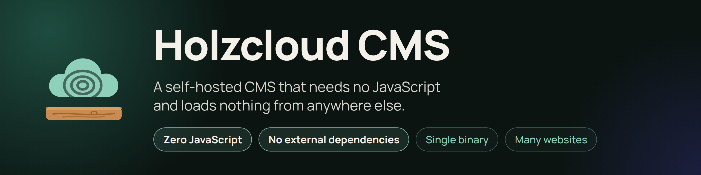
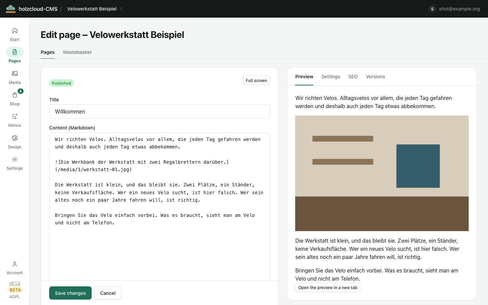
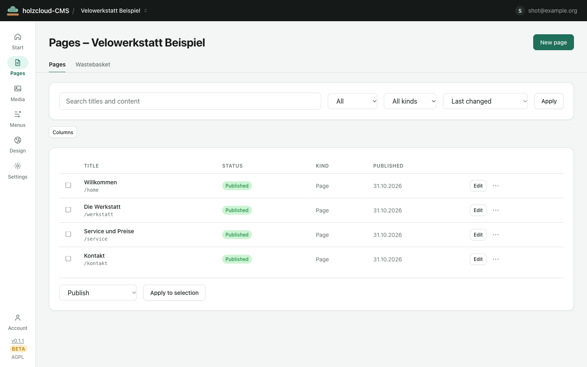
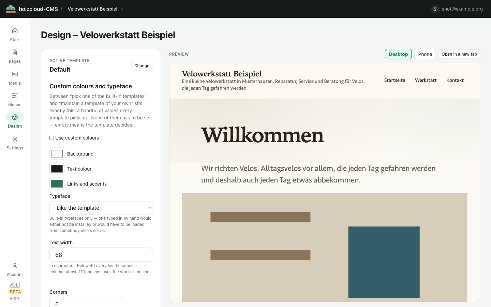
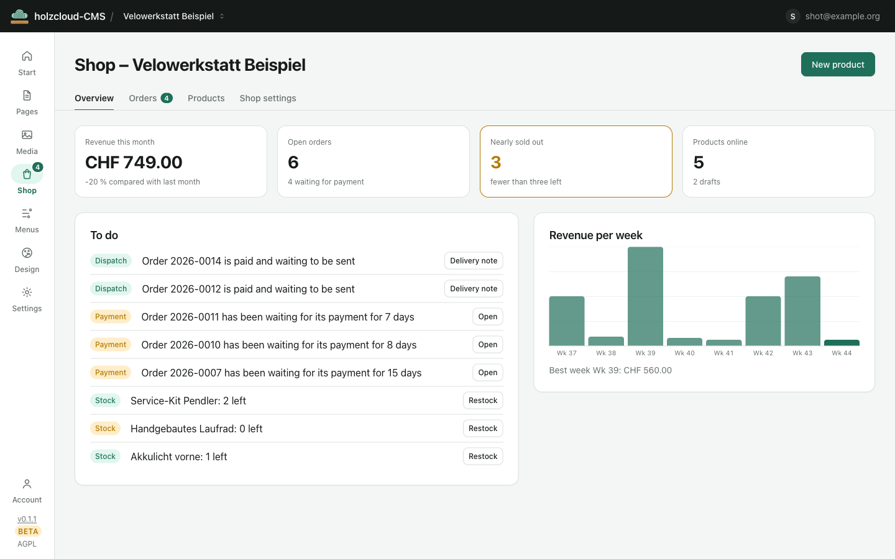
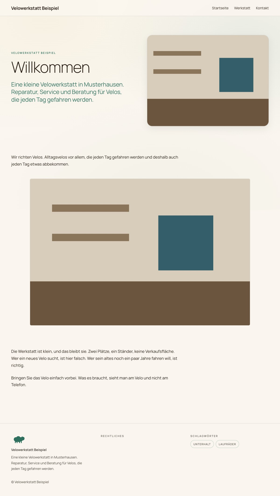

<p align="center">
  
</p>

<p align="center">
  
  <a href="https://github.com/holzcloud/holzcloud-cms/releases"></a>
  <a href="https://github.com/holzcloud/holzcloud-cms/actions/workflows/ci.yml"></a>
  <a href="LICENSE"></a>
</p>

**holzcloud-CMS** is a self-hosted CMS written in Go that runs many websites
from one binary and one SQLite file. Its sites ship no JavaScript and load
nothing from third parties, so they are fast and need no cookie banner. Made in
Switzerland, free software under the AGPL-3.0.

[Project page](https://holzcloud.ch/holzcloud-cms) ·
[Releases](https://github.com/holzcloud/holzcloud-cms/releases) ·
[Documentation](#documentation)

> [!WARNING]
> **Alpha software under heavy development.** Features, settings, the template
> contract and the AI tools can change from one release to the next. Back up the
> data directory before every update and read the [changelog](CHANGELOG.md).



## Why

- **No JavaScript on the websites.** The eight built-in templates ship none, and
  an uploaded template with a script, an `onclick` or a `javascript:` link is
  refused. Visitors get HTML and CSS.
- **Nothing loaded from third parties.** No CDN, web fonts, analytics, embeds or
  update check; fonts are compiled into the binary and every page carries a
  `default-src 'self'` content security policy. That is why a site needs no
  cookie banner, which suits GDPR.
- **The admin works without JavaScript too.** Every action is an ordinary form;
  [htmx](https://htmx.org), served from this server, only makes it quicker.
- **One static binary, one SQLite file.** No database server, no PHP, no Node,
  no build step. Built for a small Linux server.
- **Many websites, many domains.** Requests are routed by `Host`. Sites can be
  multilingual, with `hreflang` and a language picker; the admin comes in German,
  English, French, Italian and Spanish.
- **Edit with your own AI assistant.** A built-in [MCP server](docs/ai-access.md)
  with about 140 tools lets Claude, ChatGPT or any MCP client do what the admin
  can. New pages stay drafts until you publish them.
- **A shop for Switzerland.** Products with stock, orders by invoice or payment
  in advance (Payrexx optional), prices in CHF, with or without VAT.
- **No lock-in.** A whole website exports as one readable archive, there is a
  WordPress importer, and `holzcloud export` writes a static copy any web host
  can serve.

It covers what many people use WordPress for (pages, posts, media, menus,
multilingual sites, SEO, a small shop), with content kinds and fields of your
own in the manner of Statamic; see the
[comparison with Statamic](docs/vergleich-statamic.md).

## A look around









More screens, such as the media library and custom fields, are described in
[Publishing](docs/publishing.md#the-admin-at-a-glance). The screenshots show a
fictional site; a complete one to import is in [`sites/`](sites/README.md).

## Install

Download `holzcloud-linux-amd64` from the
[newest release](https://github.com/holzcloud/holzcloud-cms/releases), check it
against the `.sha256` file beside it, then:

```sh
chmod +x holzcloud-linux-amd64
./holzcloud-linux-amd64
```

Open <http://localhost:8080/admin>, create the first account (administrators set
up a TOTP second factor right after), then add a website and its domain under
**Websites**.

There is also a container image, `ghcr.io/holzcloud/holzcloud-cms`. To build
from source you need Go 1.26 and nothing else:

```sh
CGO_ENABLED=0 go build -trimpath -ldflags="-s -w" -o holzcloud ./cmd/holzcloud
```

Configuration is a set of `HOLZCLOUD_*` variables. A hardened systemd unit, a
Caddyfile for automatic HTTPS and a WAL-safe backup script are in
[`deploy/`](deploy/DEPLOY.md).

## Documentation

- [Deploying](deploy/DEPLOY.md): systemd, Caddy, backups, single sign-on
- [Configuration](docs/configuration.md): every environment variable, e-mail
- [Content model](docs/content-model.md): fields, content kinds, block kinds
- [Publishing](docs/publishing.md): pages, menus, media, templates, design, SEO, plugins
- [Multilingual](docs/multilingual.md)
- [Security](docs/security.md): threat model, two-factor, sign-in through OpenID Connect
- [Import and export](docs/import-export.md)
- [AI access](docs/ai-access.md): the MCP endpoint, key levels, tools
- [Architecture](docs/architecture.md) and [deployment and versioning](docs/deployment.md)
- [Changelog](CHANGELOG.md), [contributing](CONTRIBUTING.md), [security policy](SECURITY.md)

## Licence

[GNU Affero General Public License v3](LICENSE). Running it for yourself or for
clients obliges you to nothing beyond keeping the notices; if you offer a
modified version to others over a network, they are entitled to your changes.
Bundled fonts (Manrope, JetBrains Mono) are under the SIL Open Font License 1.1,
see [`VENDOR.md`](cmd/holzcloud/assets/VENDOR.md). Contributions are accepted
under the same licence.
